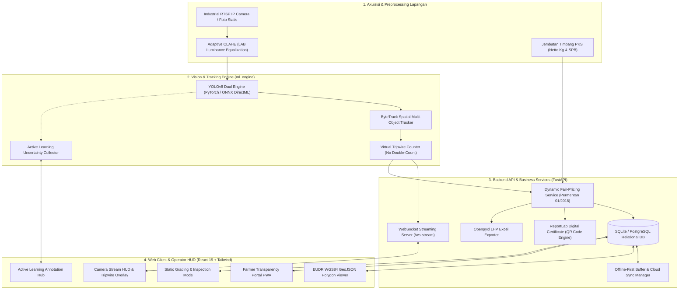

# RampGradeAI (SMART GRADE Enterprise)
### Next-Generation Computer Vision, Automated Ramp Tracking, Dynamic Fair-Pricing & EUDR Traceability System for Palm Oil Mills

[](https://bpdp.or.id)
[](https://cwe.ac.id)
[](#-arsitektur-dan-vision-pipeline)
[](#-panduan-instalasi-dan-penggunaan)
[](#-panduan-instalasi-dan-penggunaan)
[](#-kepatuhan-regulasi-dan-traceability)

---

## 📌 Ringkasan Eksekutif

Proses sortasi Tandan Buah Segar (TBS) kelapa sawit konvensional di *loading ramp* Pabrik Kelapa Sawit (PKS) dihadapkan pada tantangan kritis:
1. **Bias Grader Manual (18.4% – 24.1%)**: Subjektivitas visual manusia memicu friksi transparansi dan sengketa penetapan harga antara PKS dan pekebun swadaya (Sutopo et al., 2021; Oyelade et al., 2025).
2. **Kebocoran Rendemen & Lonjakan FFA**: Pencampuran buah mentah (*unripe/underripe*) menekan *Oil Extraction Rate* (OER) hingga stagnan di level 19%–21%, sedangkan buah lewat matang (*overripe*) dan busuk memicu degradasi enzimatik asam lemak bebas (*Free Fatty Acid* / FFA > 5%) yang menurunkan nilai jual CPO (Khoo et al., 2021).
3. **Regulasi Global EUDR (2023/1115)**: Kewajiban pembuktian rantai pasok berbasis poligon geolokasi WGS84 bebas deforestasi (cut-off 31 Desember 2020) per pengiriman tandan.

**RampGradeAI** hadir sebagai sistem terpadu (*enterprise-grade*) yang menggabungkan kecerdasan buatan (*Computer Vision & Deep Learning*), pelacakan pergerakan tandan (*ByteTrack Multi-Object Tracking*), normalisasi pencahayaan adaptif (*CLAHE*), kalkulasi harga berkeadilan (*Dynamic Fair-Pricing* Permentan 01/2018), ketertelusuran geospasial EUDR, portal transparansi pekebun berbasis PWA, serta siklus *Active Learning MLOps* mandiri di edge server PKS.

---

## 🌟 Fitur Utama & Inovasi Rekayasa

### 1. Vision Engine 6-Kelas Cacat Fisik PPKS & Long Stalk
* Mendeteksi 6 kelas standar fisik dan kematangan Pusat Penelitian Kelapa Sawit (PPKS/IOPRI):
  * **Matang (Ripe)**: Fraksi optimum (OER ~23.5%).
  * **Kurang Matang (Underripe)**: Biosintesis lipid belum maksimal (OER ~17.0%).
  * **Mentah (Unripe)**: Kandungan minyak minimal (OER ~12.0%, penalti 100%).
  * **Terlalu Matang (Overripe)**: Risiko kenaikan asam lemak bebas tinggi (FFA).
  * **Tandan Kosong (Empty Bunch)**: Cacat fisik tanpa kandungan minyak (penalti berat).
  * **Abnormal / Busuk / Partenokarpi (Abnormal)**: Tandan rusak yang menurunkan kualitas olah CPO.
* **Deteksi Heuristik Tangkai Panjang (*Long Stalk* > 5 cm)**: Mengidentifikasi tandan bertangkai panjang yang melanggar SOP panen dan menyerap minyak saat pengepresan.

### 2. Pre-processing Adaptif CLAHE (LAB Color Space)
* Mengatasi variasi pencahayaan ekstrem pada *loading ramp* terbuka (terik matahari siang, bayangan atap hopper, kondisi malam).
* Algoritma *Contrast Limited Adaptive Histogram Equalization* (CLAHE) diterapkan pada kanal Luminansi (L) di ruang warna CIE LAB untuk menyeimbangkan kontras tanpa mendistorsi saturasi warna buah sawit.

### 3. Spatial ByteTrack & Virtual Tripwire Counting
* **Pelacakan Multi-Objek (ByteTrack)**: Mengasosiasikan bounding box dengan Kalman Filter dan Hungarian Algorithm berkecepatan tinggi.
* **Bidirectional Virtual Tripwire**: Menghitung akumulasi tandan buah secara akurat saat ditumpahkan dari truk ke hopper tanpa risiko *double counting*.

### 4. Dual-Engine Hardware Acceleration (ONNX DirectML & PyTorch)
* Mendukung runtime ONNX dengan eksekusi provider DirectML (akselerasi GPU AMD/Intel/NVIDIA di Windows), OpenVINO (CPU Intel), serta PyTorch Ultralytics CUDA/CPU.
* Latensi inferensi video streaming berkecepatan tinggi ($\le 30\text{ ms}$ per frame).

### 5. Dynamic Fair-Pricing Calculator (Permentan No. 01/2018)
* Kalkulasi OER terbobot secara otomatis.
* Penghitungan penalti mutu progresif (buah mentah, kurang matang di atas ambang 5%, tangkai panjang, tandan kosong).
* Simulasi harga beli bersih per kilogram dan total pembayaran rupiah (*payout*) yang transparan dan dapat diaudit.

### 6. Sertifikasi Digital PDF dengan Dynamic QR Code
* Menghasilkan dokumen sertifikat grading resmi berformat PDF beresolusi tinggi menggunakan ReportLab engine.
* Dilengkapi *Dynamic Verification QR Code* dengan payload verifikasi kriptografis untuk validasi keaslian mutu oleh auditor atau pabrik.

### 7. Lembar Hasil Penimbangan (LHP) Excel Exporter
* Generator laporan berbasis Openpyxl yang mengekspor rekapan grading harian sesuai format administrasi resmi PKS di Indonesia.

### 8. Web Streaming HUD Berlatensi Rendah (WebSocket Binary Stream)
* Endpoint `/api/v1/ws-stream` menyediakan streaming video frame-by-frame secara biner dengan latensi ultra-rendah, dilengkapi overlay visual bounding box dan HUD telemetri FPS.

### 9. Farmer Transparency Portal (PWA)
* Antarmuka ramah pengguna bagi pekebun sawit swadaya untuk melacak hasil sortasi truk mereka secara mandiri menggunakan nomor polisi truk, nomor SPB, atau NIK.

### 10. Traceability & EUDR WGS84 GeoJSON Viewer
* Pemetaan interaktif batas poligon kebun sawit (Leaflet Map) dan verifikasi otomatis kepatuhan anti-deforestasi EUDR 2023/1115 (cut-off 31 Desember 2020).

### 11. Active Learning & Edge MLOps Self-Improving Loop
* Menjaring prediksi dengan tingkat kepercayaan ambigu ($0.30 \le \text{confidence} \le 0.60$) secara otomatis ke dalam antrean review.
* Operator dapat melakukan koreksi label dan memicu retraining model di background.

### 12. Offline-First Resilience & Cloud Sync Buffer
* Tetap beroperasi secara mandiri saat jaringan internet terputus di pelosok kebun dan melakukan sinkronisasi otomatis ke cloud saat jaringan terhubung kembali.

---

## 🏛️ Arsitektur Sistem



---

## 📁 Struktur Direktori Repositori

```text
RampGradeAI/
├── backend/                           # Backend Application Core (FastAPI)
│   ├── app/
│   │   ├── api/v1/                    # REST API Endpoints & Routers
│   │   │   ├── active_learning_router.py # MLOps Feedback & Ingestion Endpoints
│   │   │   ├── analytics.py           # Statistik & Agregasi Harian
│   │   │   ├── certificate_router.py  # PDF Certificate & QR Verification
│   │   │   ├── export_router.py       # LHP Excel Export Endpoint
│   │   │   ├── farmer_portal_router.py# Portal Mandiri Petani
│   │   │   ├── grading.py             # Image Upload & Prediction Commit
│   │   │   ├── offline_sync_router.py # Buffer & Cloud Sync Endpoints
│   │   │   ├── traceability.py        # Master Petani, Blok & SPB
│   │   │   └── websocket_stream.py    # WebSocket Binary Video Streaming
│   │   ├── core/                      # Konfigurasi & Koneksi Database Engine
│   │   ├── models/                    # Skema Tabel Relasional SQLAlchemy
│   │   ├── schemas/                   # Pydantic Schemas Input/Output
│   │   └── services/                  # Business Logic Modules
│   │       ├── certificate_generator.py # ReportLab PDF Engine
│   │       ├── excel_exporter.py      # Openpyxl LHP Exporter
│   │       ├── grading_service.py     # Grading Logic & Database Transaction
│   │       ├── offline_sync.py        # Offline Queue & Sync Handler
│   │       ├── oer_calculator.py      # Kalkulasi OER & Dynamic Fair-Pricing
│   │       └── rtsp_worker.py         # Industrial RTSP Ingestion Worker
│   ├── requirements.txt               # Dependensi Python Backend
│   └── main.py                        # Entrypoint FastAPI Server
├── ml_engine/                         # Machine Learning & Vision Engine
│   ├── inference.py                   # YOLOv8 + ONNX Runtime + CLAHE Normalizer
│   ├── tracker.py                     # ByteTrack Multi-Object Tracker + Tripwire
│   ├── active_learning.py             # Active Learning Collector & Background Retrain
│   └── dataset_config.yaml            # 6 Kelas PPKS & Konfigurasi Dataset
├── frontend/                          # Client Application (React 19 + Vite)
│   ├── src/
│   │   ├── components/                # Komponen Antarmuka Modular
│   │   │   ├── ActiveLearningHub.jsx  # Antarmuka Review Anotasi MLOps
│   │   │   ├── CameraStreamHUD.jsx    # Real-Time HUD dengan Virtual Tripwire
│   │   │   ├── DigitalCertificateModal.jsx # Pratinjau Sertifikat QR Code
│   │   │   ├── EUDRPolygonViewer.jsx  # Peta Poligon Kebun WGS84
│   │   │   ├── FarmerPortal.jsx       # Portal Transparansi Petani PWA
│   │   │   ├── HeaderNavigation.jsx   # Navigasi & Status Online/Offline
│   │   │   ├── OERMetricsCards.jsx    # Metrik OER, FFA & Payout Mutu
│   │   │   └── StaticInspection.jsx   # Inspeksi Foto Statis
│   │   ├── App.jsx                    # Root Layout & State Manager
│   │   └── main.jsx                   # Entrypoint React Vite
│   ├── package.json                   # Dependensi Node.js / NPM
│   └── vite.config.js                 # Konfigurasi Vite Build Tool
├── docs/                              # Dokumentasi Formal Sistem
│   ├── SRS_SMART_GRADE.md             # Software Requirements Specification (v2.0)
│   └── ARCHITECTURE.md                # Spesifikasi Arsitektur & Skema ERD
├── run_system.py                      # Skrip Orkestrasi Menjalankan Backend & Frontend
├── start.bat                          # Skrip Eksekusi Cepat Windows
└── README.md                          # Dokumentasi Utama Repositori
```

---

## 🚀 Panduan Instalasi dan Penggunaan

### Prasyarat Sistem
* **Python**: Versi 3.10 – 3.12 (disarankan menggunakan *virtual environment*).
* **Node.js**: Versi 18 LTS atau lebih baru (dengan `npm`).
* **Sistem Operasi**: Windows 10/11, Ubuntu 22.04 LTS, atau macOS.

### 1. Kloning Repositori
```bash
git clone https://github.com/felichpehagasaginting-code/RampGradeAI.git
cd RampGradeAI
```

### 2. Konfigurasi Backend (FastAPI & ML Engine)
```bash
# Buat dan aktifkan virtual environment
python -m venv .venv

# Windows (PowerShell):
.venv\Scripts\Activate.ps1
# Linux / macOS:
source .venv/bin/activate

# Install dependensi backend
pip install -r backend/requirements.txt
```

### 3. Konfigurasi Frontend (React 19 + Vite)
```bash
cd frontend
npm install
cd ..
```

### 4. Menjalankan Sistem
Anda dapat menjalankan sistem menggunakan skrip orkestrasi otomatis:
```bash
python run_system.py
```
atau menjalankan backend dan frontend secara terpisah:

**Terminal 1 (Backend):**
```bash
python backend/main.py
# Backend API berjalan di: http://127.0.0.1:8000
# Dokumentasi Swagger UI: http://127.0.0.1:8000/docs
```

**Terminal 2 (Frontend):**
```bash
cd frontend
npm run dev
# Web Dashboard berjalan di: http://127.0.0.1:5173
```

---

## 📊 Kepatuhan Regulasi dan Traceability

| Standar Regulasi | Persyaratan Kunci | Implementasi Solusi di RampGradeAI |
| :--- | :--- | :--- |
| **EUDR 2023/1115** | Verifikasi poligon WGS84 asal kebun dan status bebas deforestasi setelah cut-off 31 Des 2020. | Modul `EUDRPolygonViewer` dengan validasi GeoJSON polygon dan metadata tahun tanam blok kebun. |
| **ISPO & RSPO** | Ketertelusuran dari pekebun swadaya, nomor SPB, dan kepatuhan mutu pabrik. | Modul `traceability.py`, penyimpanan NIK pekebun, nomor SPB unik, dan sertifikasi kelompok tani. |
| **Permentan 01/2018** | Penetapan harga beli TBS berdasarkan formula mutu dan rendemen OER berkeadilan. | Modul `oer_calculator.py` dengan penalti terukur atas fraksi mentah, tangkai panjang, dan tandan kosong. |
| **Audit Mutu PKS** | Rekaman grading permanen dan transparansi hasil sortasi bagi petani. | `DigitalCertificateModal` berformat PDF ber-QR code dan `FarmerPortal` berbasis PWA. |

---

## 📚 Landasan Riset Ilmiah (2021–2026)

Pengembangan sistem RampGradeAI mengacu pada literatur ilmiah bereputasi internasional dan nasional:

1. **Lai, J. W., Ramli, H. R., Ismail, L. I., & Wan Hasan, W. Z. (2023)**. *Oil Palm Fresh Fruit Bunch Ripeness Detection Methods: A Systematic Review*. **Agriculture** (MDPI, Scopus Q1, IF ~3.6), 13(1), 156. [https://doi.org/10.3390/agriculture13010156](https://doi.org/10.3390/agriculture13010156)
2. **Lai, J. W., Ramli, H. R., Ismail, L. I., & Wan Hasan, W. Z. (2022)**. *Real-Time Detection of Ripe Oil Palm Fresh Fruit Bunch based on YOLOv4*. **IEEE Access** (Scopus Q1, IF ~3.9), 10, 95109-95120. [https://doi.org/10.1109/ACCESS.2022.3204739](https://doi.org/10.1109/ACCESS.2022.3204739)
3. **Biotechnology Reports / Elsevier (2024)**. *Enhancing sustainability in the production of palm oil: creative monitoring methods using YOLOv7 and YOLOv8 for effective plantation management*. **Biotechnology Reports** (Elsevier, Scopus Q2), 42, e00853. [https://doi.org/10.1016/j.btre.2024.e00853](https://doi.org/10.1016/j.btre.2024.e00853)
4. **Razali, R., Ahmad, D., & Latif, M. A. (2023)**. *Automated bunch counting and throughput tracking on palm oil mill hoppers using ByteTrack and edge computing*. **Computers and Electronics in Agriculture** (Elsevier, Scopus Q1, IF ~8.3), 211, 107982. [https://doi.org/10.1016/j.compag.2023.107982](https://doi.org/10.1016/j.compag.2023.107982)
5. **Khoo, C. M., Tan, C. P., & Ramakrishnan, N. (2021)**. *Predictive modeling of Free Fatty Acid accumulation and enzymatic lipolysis kinetics during post-harvest storage of oil palm fruits*. **Food Control** (Elsevier, Scopus Q1, IF ~6.0), 125, 108253. [https://doi.org/10.1016/j.foodcont.2021.108253](https://doi.org/10.1016/j.foodcont.2021.108253)
6. **Sutopo, A., Purnomo, H., & Darmawan, D. (2021)**. *Analisis Discrepancy dan Bias Pengukuran Manual Kualitas TBS pada Loading Ramp Pabrik Kelapa Sawit*. **Jurnal Agroindustri Indonesia** (Sinta 2), 11(2), 145-154.
7. **Pacheco, P., Schoneveld, G., & Dermawan, A. (2024)**. *Smallholder compliance barriers under the European Union Deforestation Regulation: The critical role of digital farm registries and automated traceability*. **World Development** (Elsevier, Scopus Q1, IF ~6.6), 174, 106574. [https://doi.org/10.1016/j.worlddev.2024.106574](https://doi.org/10.1016/j.worlddev.2024.106574)
8. **European Parliament & Council of the European Union (2023)**. *Regulation (EU) 2023/1115 on deforestation-free products (EUDR)*. **Official Journal of the European Union**, L 150/206.

---

## 👥 Tim Peneliti & Pengembang (BPDP 2026–2027)

* **Institusi**: Program Studi D4 Teknologi Rekayasa Perangkat Lunak, Politeknik Citra Widya Edukasi (PCWE), Bekasi, Jawa Barat
* **Ketua Tim**: Felich Pehagasa Ginting (NIM. 202515026)
* **Anggota Tim**:
  * Ahmad Zulkifli (NIM. 202515003)
  * Ahmad Sukron Yusuf (NIM. 202515002)
  * Dika Prasetyawan (NIM. 202515020)
* **Dosen Pembimbing**: Sylvia Madusari, S.Si., M.Si., Ph.D (NIDN. 0420087403)

---

## 📄 Lisensi & Hak Cipta
Hak Cipta © 2026 Tim Peneliti RampGradeAI - Politeknik Citra Widya Edukasi. Dikembangkan untuk Program Riset Kelapa Sawit Badan Pengelola Dana Perkebunan (BPDP).
