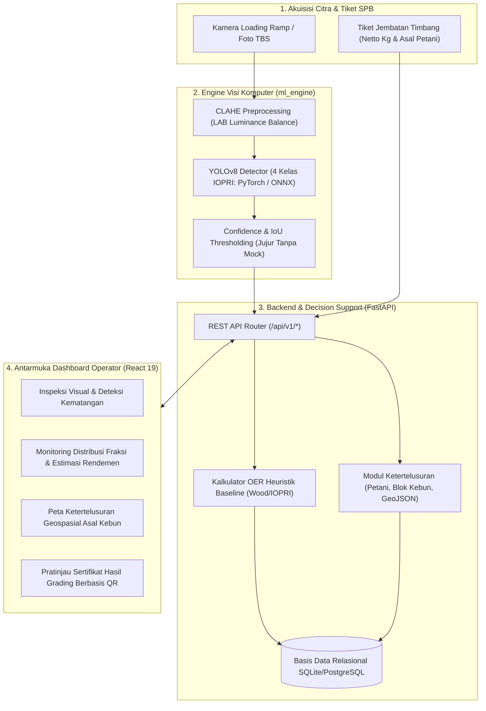

# SMART GRADE / RampGradeAI
### Purwarupa Awal Sistem Deteksi Kematangan TBS (Smart Indicator) Berbasis Deep Learning & Ketertelusuran Rantai Pasok PKS

[](https://bpdp.or.id)
[](https://cwe.ac.id)
[-blue.svg)](#-status-pengembangan-dan-posisi-riset-bpdp)
[](#-panduan-instalasi-dan-pengujian)
[](#-panduan-instalasi-dan-pengujian)

---

## 📌 Ringkasan Eksekutif & Konteks Riset

Repositori ini memuat **desain arsitektur perangkat lunak dan purwarupa studi kelayakan awal (Preliminary Software Prototype / TRL 3)** untuk usulan penelitian:
> **"SMART GRADE: Pengembangan Alat Deteksi Kematangan Buah Sawit (Smart Indicator) Berbasis Deep Learning untuk Optimalisasi Oil Extraction Rate di Pabrik Kelapa Sawit"**  
> *Program Lomba Riset Tingkat Mahasiswa - Badan Pengelola Dana Perkebunan (BPDP) 2026–2027.*

### Masalah yang Diteliti
1. **Subjektivitas & Bias Sortasi Manual**: Penilaian visual kematangan Tandan Buah Segar (TBS) di *loading ramp* jembatan timbang Pabrik Kelapa Sawit (PKS) memiliki keterbatasan konsistensi antar individu maupun antar waktu (kelelahan petugas, rotasi shift, dan perbedaan persepsi visual).
2. **Stagnasi Rendemen Minyak (OER)**: Masuknya fraksi buah mentah (*unripe/underripe*) ke jalur perebusan (*sterilizer*) menekan *Oil Extraction Rate* nasional yang stagnan pada kisaran 19%–21%, sedangkan buah lewat matang (*overripe*) meningkatkan risiko kenaikan asam lemak bebas (*Free Fatty Acid* / FFA).
3. **Kebutuhan Ketertelusuran Rantai Pasok (Traceability)**: Tuntutan sertifikasi ISPO, RSPO, dan regulasi global EUDR (2023/1115) mewajibkan pencatatan asal-usul TBS hingga ke tingkat pekebun dan poligon koordinat blok kebun.

---

## 🎯 Fokus 4 Fraksi Kematangan Standar IOPRI (1997)

Sistem dirancang mengklasifikasikan TBS ke dalam **4 kelas fraksi kematangan resmi Pusat Penelitian Kelapa Sawit (PPKS/IOPRI 1997)**:
1. **Mentah (Unripe)**: Buah berwarna hitam pekat/keunguan, brondolan belum lepas, potensi rendemen minimal.
2. **Kurang Matang (Underripe)**: Buah mulai kemerahan, <10 brondolan lepas alami, sintesis lipid belum maksimal.
3. **Matang (Ripe)**: Fraksi panen ideal, >10 brondolan lepas alami, warna oranye kemerahan merata, rendemen minyak maksimum.
4. **Terlalu Matang (Overripe)**: Buah kehitaman lembek, >50% brondolan lepas/jatuh, berisiko FFA tinggi.

---

## 🔬 Status Pengembangan & Posisi Riset BPDP (Kriteria Orisinalitas)

> [!IMPORTANT]
> **Pernyataan Integritas Ilmiah & Ruang Lingkup Usulan:**  
> Repositori ini berfungsi sebagai **bukti kelayakan rekayasa perangkat lunak (Software Engineering Feasibility Proof)** bahwa tim peneliti memiliki kesiapan infrastruktur komputasi untuk mengintegrasikan model visi komputer dengan alur administrasi pabrik.  
> **Riset yang diajukan ke BPDP adalah kegiatan baru yang belum didanai**, yang berfokus pada:
> 1. **Pengambilan Dataset Primer Lapangan**: Pengambilan ribuan citra TBS langsung di PKS mitra guna menangkap variasi varietas sawit Indonesia dan kondisi pencahayaan riil di loading ramp (pagi, terik siang, berdebu, mendung).
> 2. **Pelatihan & Validasi Model Lapangan**: Fine-tuning arsitektur YOLOv8 pada data primer dan evaluasi metrik $mAP@0.5$, Precision, Recall, dan Confusion Matrix.
> 3. **Kalibrasi Empiris Formula OER**: Mengkalibrasi koefisien rendemen minyak berbasis pengujian laboratorium kimia ekstraksi Soxhlet di PKS mitra (bukan sekadar parameter baseline).
> 4. **Uji Komparasi Head-to-Head**: Pengujian perbandingan langsung performa grading AI vs petugas grader manusia berpengalaman di PKS mitra.

---

## 🏛️ Arsitektur Sistem SMART GRADE



---

## 📁 Struktur Direktori Repositori

```text
YoloGrading/
├── backend/                           # Backend Application Core (FastAPI)
│   ├── app/
│   │   ├── api/v1/                    # REST API Endpoints & Routers
│   │   │   ├── analytics.py           # Agregasi Ringkasan Mutu Harian
│   │   │   ├── blocks.py              # Master Blok Kebun & Poligon Geospasial
│   │   │   ├── delivery_orders.py     # Tiket Penerimaan TBS (SPB)
│   │   │   ├── farmers.py             # Master Data Petani & Kelompok Tani
│   │   │   ├── grading.py             # Endpoint Inferensi & Komitmen Sesi
│   │   │   └── router.py              # Registrasi Seluruh Router v1
│   │   ├── core/                      # Konfigurasi Pydantic & Koneksi DB
│   │   ├── models/                    # Model Relasional SQLAlchemy
│   │   ├── schemas/                   # Skema DTO Validasi Input/Output
│   │   └── services/                  # Logika Domain (OER Calculator Baseline)
│   ├── requirements.txt               # Daftar Dependensi Python
│   └── test_backend.py                # Pengujian Integritas Unit Test
├── ml_engine/                         # Modul Deep Learning (YOLOv8)
│   ├── inference.py                   # Wrapper Inferensi YOLO/ONNX (Tanpa Mock Palsu)
│   ├── dataset_config.yaml            # Definisi 4 Kelas Kematangan IOPRI
│   └── download_dataset.py            # Skrip Unduh Dataset (Via Environment Variable)
├── frontend/                          # Web Dashboard Operator (React 19 + Vite)
│   ├── src/                           # Komponen UI (Inspeksi, OER, Peta, Sertifikat)
│   └── package.json                   # Dependensi Frontend
├── docs/                              # Dokumentasi Spesifikasi Sistem
│   ├── SRS_SMART_GRADE.md             # Dokumen Spesifikasi Kebutuhan Perangkat Lunak
│   └── ARCHITECTURE.md                # Spesifikasi Teknis & Skema Relasional
├── run_system.py                      # Skrip Peluncur Sistem Simultan
├── start.bat                          # Skrip Eksekusi Cepat Windows
└── README.md                          # Dokumentasi Utama Repositori
```

---

## 🚀 Panduan Instalasi dan Pengujian

### 1. Prasyarat Sistem
* Python 3.10 – 3.12
* Node.js 18 LTS atau lebih baru

### 2. Konfigurasi Backend & ML Engine
```bash
# Buat dan aktifkan virtual environment
python -m venv .venv
.venv\Scripts\activate   # Pada Windows
# source .venv/bin/activate  # Pada Linux/macOS

# Pasang dependensi
pip install -r backend/requirements.txt

# Jalankan pengujian integritas backend
python backend/test_backend.py
```

### 3. Menjalankan Server Backend
```bash
.venv\Scripts\python.exe backend/main.py
# Backend API berjalan di: http://127.0.0.1:8000
# Dokumentasi Interaktif Swagger UI: http://127.0.0.1:8000/docs
```

### 4. Menjalankan Dashboard Frontend
```bash
cd frontend
npm install
npm run dev
# Dashboard berjalan di: http://127.0.0.1:5173
```

---

## 📚 Landasan Pustaka Ilmiah

Perancangan purwarupa ini merujuk pada literatur ilmiah dan regulasi resmi:

1. **Lai, J. W., Ramli, H. R., Ismail, L. I., & Wan Hasan, W. Z. (2023)**. *Oil Palm Fresh Fruit Bunch Ripeness Detection Methods: A Systematic Review*. **Agriculture** (MDPI, Scopus Q1), 13(1), 156. [https://doi.org/10.3390/agriculture13010156](https://doi.org/10.3390/agriculture13010156)
2. **Lai, J. W., Ramli, H. R., Ismail, L. I., & Wan Hasan, W. Z. (2022)**. *Real-Time Detection of Ripe Oil Palm Fresh Fruit Bunch based on YOLOv4*. **IEEE Access** (Scopus Q1), 10, 95109-95120. [https://doi.org/10.1109/ACCESS.2022.3204739](https://doi.org/10.1109/ACCESS.2022.3204739)
3. **Pusat Penelitian Kelapa Sawit (PPKS / IOPRI) (1997)**. *Standar Kriteria Fraksi Kematangan Tandan Buah Segar Kelapa Sawit*. Medan: IOPRI.
4. **Wood, B. J., et al.**. *Harvesting and Ripeness Standards in Oil Palm Management*. Planter, Kuala Lumpur.
5. **Kementerian Pertanian Republik Indonesia (2018)**. *Peraturan Menteri Pertanian No. 01/PERMENTAN/KB.120/1/2018 tentang Pedoman Penetapan Harga Pembelian Tandan Buah Segar Kelapa Sawit Produksi Pekebun*.
6. **European Parliament & Council of the European Union (2023)**. *Regulation (EU) 2023/1115 on Deforestation-free Products (EUDR)*. Official Journal of the European Union, L 150/206.

---

## 👥 Tim Peneliti & Pengusul (BPDP 2026–2027)

* **Institusi**: Program Studi D4 Teknologi Rekayasa Perangkat Lunak, Politeknik Citra Widya Edukasi (PCWE), Bekasi, Jawa Barat
* **Ketua Tim**: Felich Pehagasa Ginting (NIM. 202515026)
* **Anggota Tim**:
  * Ahmad Zulkifli (NIM. 202515003)
  * Ahmad Sukron Yusuf (NIM. 202515002)
  * Dika Prasetyawan (NIM. 202515020)
* **Dosen Pembimbing**: Sylvia Madusari, S.Si., M.Si., Ph.D (NIDN. 0420087403)

---

## 📄 Lisensi & Hak Cipta
Hak Cipta © 2026 Tim Peneliti SMART GRADE - Politeknik Citra Widya Edukasi. Dikembangkan untuk usulan Program Riset Kelapa Sawit Badan Pengelola Dana Perkebunan (BPDP).
