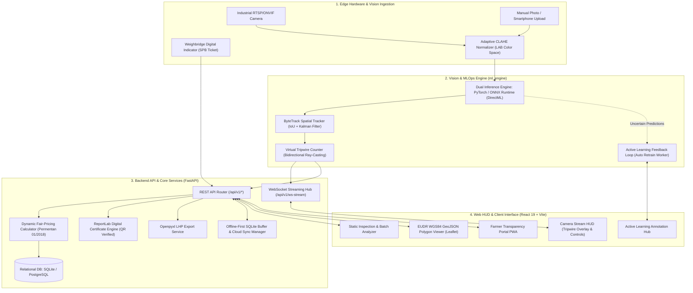

# Spesifikasi Arsitektur Sistem & Desain Teknis (RampGradeAI)
## Sistem Cerdas Grading TBS, Multi-Object Tracking & Traceability EUDR

Dokumen ini mendefinisikan arsitektur teknis, desain basis data relasional (ERD), pipeline inferensi vision, dan kontrak antarmuka API untuk sistem **RampGradeAI** (SMART GRADE Enterprise).

---

## 1. Arsitektur Komponen Sistem



---

## 2. Skema Basis Data Relasional (Entity Relationship Diagram - ERD)

```mermaid
erDiagram
    FARMER ||--o{ PLANTATION_BLOCK : "memiliki"
    PLANTATION_BLOCK ||--o{ DELIVERY_ORDER : "sumber_buah"
    FARMER ||--o{ DELIVERY_ORDER : "mengirim"
    DELIVERY_ORDER ||--|| GRADING_SESSION : "memiliki_sesi"
    GRADING_SESSION ||--o{ DETECTION_ITEM : "menghasilkan"
    GRADING_SESSION ||--|| OER_ASSESSMENT : "menghasilkan_kalkulasi"
    GRADING_SESSION ||--o{ ACTIVE_LEARNING_SAMPLE : "memicu_sampel"

    FARMER {
        int id PK
        string farmer_code UK "FMR-YYYY-XXXX"
        string name "Nama Pekebun/Koperasi"
        string nik "Nomor Induk Kependudukan (16 digit)"
        string phone_number
        string cooperative_name "Kelompok Tani / Koperasi Unit Desa"
        string certification_status "NONE / ISPO / RSPO / BOTH"
        datetime created_at
    }

    PLANTATION_BLOCK {
        int id PK
        int farmer_id FK
        string block_code UK "BLK-XXXX"
        float area_hectares "Luas Kebun (Hektar)"
        float latitude "Titik Pusat WGS84"
        float longitude "Titik Pusat WGS84"
        text boundary_geojson "Koordinat Poligon Batas Kebun WGS84"
        boolean eudr_compliant "Status Bebas Deforestasi (Cut-off Dec 2020)"
        int planting_year "Tahun Tanam"
        string variety "Varietas Bibit (DxP Marihat, Yangambi, dll)"
        string legal_status "SHM / HGU / Girik"
    }

    DELIVERY_ORDER {
        int id PK
        string spb_number UK "Surat Pengantar Buah (SPB-XXXX)"
        int farmer_id FK
        int block_id FK
        string truck_plate_number "Nomor Polisi Truk"
        string driver_name
        float net_weight_kg "Berat Bersih TBS Jembatan Timbang (Kg)"
        datetime arrival_time
        string status "PENDING_GRADING / COMPLETED / REJECTED"
    }

    GRADING_SESSION {
        int id PK
        int delivery_order_id FK UK
        string session_code UK "GRD-YYYYMMDD-XXXX"
        string operator_name "Petugas Grader Lapangan"
        string image_path "Path Citra Bukti Grading"
        int total_bunches "Total TBS Terdeteksi"
        int count_unripe "Jumlah TBS Mentah"
        int count_underripe "Jumlah TBS Kurang Matang"
        int count_ripe "Jumlah TBS Matang"
        int count_overripe "Jumlah TBS Lewat Matang"
        int count_empty_bunch "Jumlah Tandan Kosong"
        int count_abnormal "Jumlah Tandan Abnormal / Busuk"
        int count_long_stalk "Jumlah Tandan Bertangkai Panjang > 5cm"
        int tripwire_total_count "Jumlah Akumulasi Melintasi Tripwire"
        float inference_latency_ms "Latensi Inferensi (ms)"
        string model_version "Versi Model Vision"
        boolean active_learning_flag "Menandai Sampel Masuk Review MLOps"
        datetime graded_at
    }

    DETECTION_ITEM {
        int id PK
        int grading_session_id FK
        string class_name "ripe / underripe / unripe / overripe / empty_bunch / abnormal"
        float confidence "Skor Kepercayaan 0.0 - 1.0"
        float bbox_x1
        float bbox_y1
        float bbox_x2
        float bbox_y2
        boolean has_long_stalk "Tangkai Panjang Terdeteksi"
    }

    OER_ASSESSMENT {
        int id PK
        int grading_session_id FK UK
        float estimated_oer_percentage "Estimasi Rendemen Minyak (OER %)"
        float baseline_oer_percentage "Standar Kontrak PKS (e.g. 21.5%)"
        float oer_variance "Deviasi Terhadap Baseline"
        float quality_score "Indeks Mutu TBS 0.0 - 1.0"
        float price_per_kg_base "Harga Patokan Disbun (Rp/Kg)"
        float price_penalty_percentage "Persentase Potongan Penalti Mutu (%)"
        float stalk_penalty_percentage "Persentase Penalti Tangkai Panjang (%)"
        float final_price_per_kg "Harga Beli Bersih Diterima Petani (Rp/Kg)"
        float total_payout "Total Pembayaran Bersih (Rp)"
        string ffa_risk_category "LOW / MEDIUM / HIGH"
        datetime calculated_at
    }

    ACTIVE_LEARNING_SAMPLE {
        int id PK
        int grading_session_id FK
        string original_image_path
        string inferred_labels_json
        string human_verified_labels_json
        float min_confidence_score
        string review_status "PENDING / LABELED / DISCARDED / RETRAINED"
        datetime created_at
        datetime reviewed_at
    }
```

---

## 3. Pipeline Pemrosesan Citra & Tracking Vision

1. **Input Frame Acquisition**: Citra masuk via HTTP upload atau RTSP video frame.
2. **CLAHE Enhancement**:
   - Citra dikonversi dari BGR ke color space CIE LAB.
   - Algoritma CLAHE (*Clip Limit* = 2.0, *Grid Size* = 8×8) diterapkan pada kanal Luminansi (L) untuk menyeimbangkan paparan cahaya tanpa merusak saturasi warna buah sawit.
   - Citra dikembalikan ke format BGR.
3. **Multi-Defect Object Detection**:
   - Model YOLOv8 (PyTorch / ONNX) mengeksekusi inferensi pada citra ternormalisasi.
   - Menghasilkan prediksi bounding boxes untuk 6 kelas: `ripe`, `underripe`, `unripe`, `overripe`, `empty_bunch`, `abnormal`.
   - Analisis rasio aspek tangkai mendeteksi cacat fisik `long stalk`.
4. **ByteTrack Spatial Association**:
   - Kotak deteksi dipadankan dengan lintasan objek aktif (*active tracks*) menggunakan kombinasi matriks Kalman Filter dan Hungarian IoU Matching.
   - Setiap tandan buah mempertahankan ID numerik stabil selama berada di area hopper.
5. **Virtual Tripwire Counting**:
   - Garis virtual didefinisikan secara fleksibel pada koordinat kanvas video.
   - Vektor perpindahan lintasan diuji menggunakan uji potong garis (*ray-casting line intersection*).
   - TBS yang melintasi garis dihitung satu kali dan memperbarui statistik live.
6. **Active Learning Ingestion**:
   - Frame dengan prediksi ambigu ($0.30 \le \text{confidence} \le 0.60$) disaring dan disimpan ke antrean review MLOps.

---

## 4. Kontrak REST & WebSocket API (FastAPI)

### A. Traceability & Master Data
| Method | Endpoint | Deskripsi |
| :--- | :--- | :--- |
| `GET` | `/api/v1/farmers` | Mengambil daftar seluruh pekebun terdaftar |
| `POST` | `/api/v1/farmers` | Mendaftarkan pekebun baru |
| `GET` | `/api/v1/blocks` | Mengambil daftar blok kebun (mendukung filter `farmer_id`) |
| `POST` | `/api/v1/blocks` | Mendaftarkan blok kebun baru beserta poligon WGS84 GeoJSON |
| `GET` | `/api/v1/delivery-orders` | Mengambil daftar Surat Pengantar Buah (SPB) |
| `POST` | `/api/v1/delivery-orders` | Membuat tiket penerimaan TBS baru di jembatan timbang |

### B. Grading & Vision Inference
| Method | Endpoint | Deskripsi |
| :--- | :--- | :--- |
| `POST` | `/api/v1/grading/predict` | Mengunggah foto TBS, menjalankan inferensi dengan opsi CLAHE & engine selector |
| `POST` | `/api/v1/grading/commit` | Mengesahkan dan mengunci sesi grading ke tiket SPB |
| `GET` | `/api/v1/grading/sessions/{id}` | Mengambil data lengkap sesi grading |

### C. Live Video Streaming & Tracking
| Method | Endpoint | Deskripsi |
| :--- | :--- | :--- |
| `WebSocket` | `/api/v1/ws-stream` | Streaming video dua arah berlatensi ultra-rendah dengan overlay bounding box dan tripwire counter |
| `POST` | `/api/v1/stream/configure-tripwire` | Mengonfigurasi koordinat garis virtual tripwire |

### D. Digital Certificate & Reporting
| Method | Endpoint | Deskripsi |
| :--- | :--- | :--- |
| `GET` | `/api/v1/certificate/{session_id}/pdf` | Menghasilkan dan mengunduh sertifikat digital PDF dengan dynamic QR Code |
| `GET` | `/api/v1/certificate/verify/{hash}` | Endpoint verifikasi keabsahan sertifikat grading |
| `GET` | `/api/v1/reports/lhp/excel` | Mengekspor Lembar Hasil Penimbangan (LHP) dalam format Excel (.xlsx) |

### E. Farmer Transparency Portal & PWA
| Method | Endpoint | Deskripsi |
| :--- | :--- | :--- |
| `GET` | `/api/v1/farmer-portal/search` | Mencari data grading berdasarkan nomor polisi truk, SPB, atau NIK |
| `GET` | `/api/v1/farmer-portal/summary/{farmer_id}` | Mengambil rekapitulasi riwayat tonase, OER rata-rata, dan total payout petani |

### F. Active Learning MLOps & Offline-First Sync
| Method | Endpoint | Deskripsi |
| :--- | :--- | :--- |
| `GET` | `/api/v1/active-learning/queue` | Mengambil antrean citra ambigu untuk verifikasi anotasi manusia |
| `POST` | `/api/v1/active-learning/submit` | Menyimpan koreksi label bounding box |
| `POST` | `/api/v1/active-learning/trigger-retrain`| Menjalankan background retraining model |
| `POST` | `/api/v1/offline-sync/push` | Mengirim data buffer sesi grading dari edge offline ke cloud |
| `GET` | `/api/v1/offline-sync/status` | Mengecek status dan antrean sinkronisasi |
